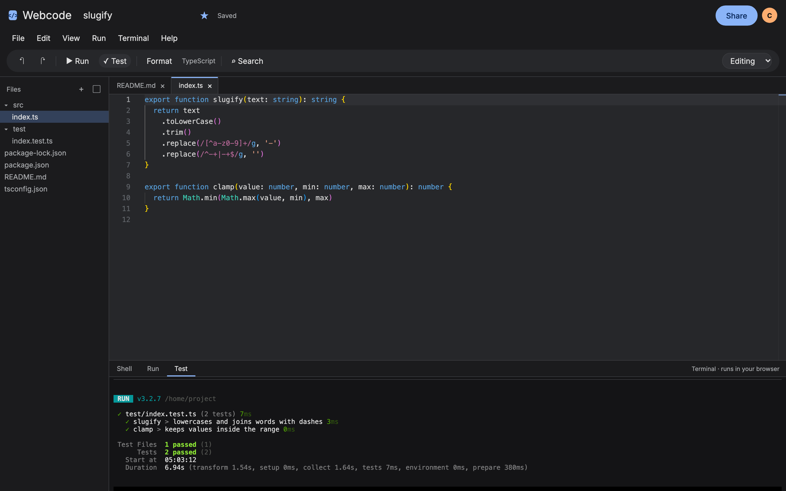
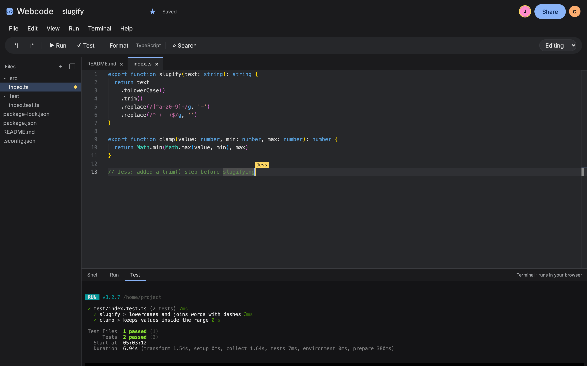
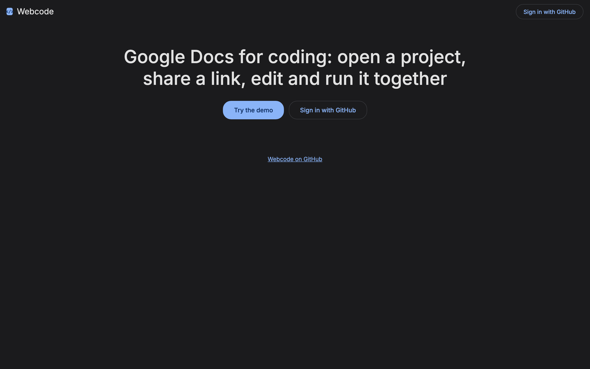
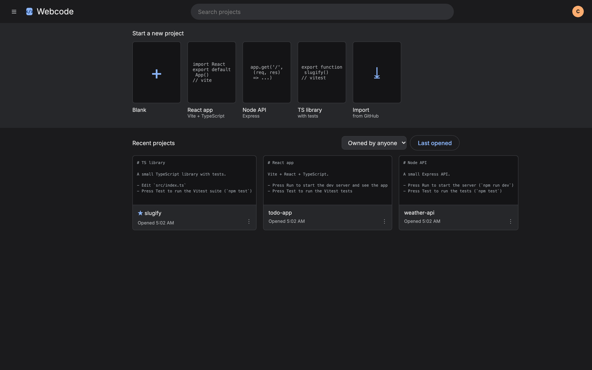
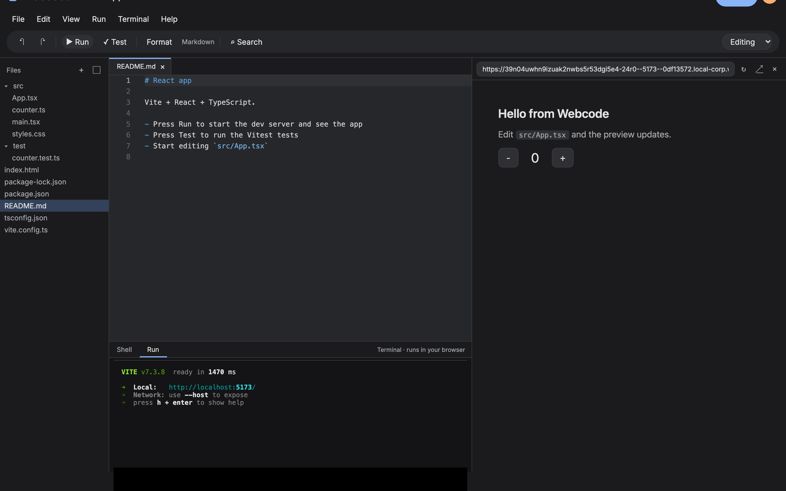
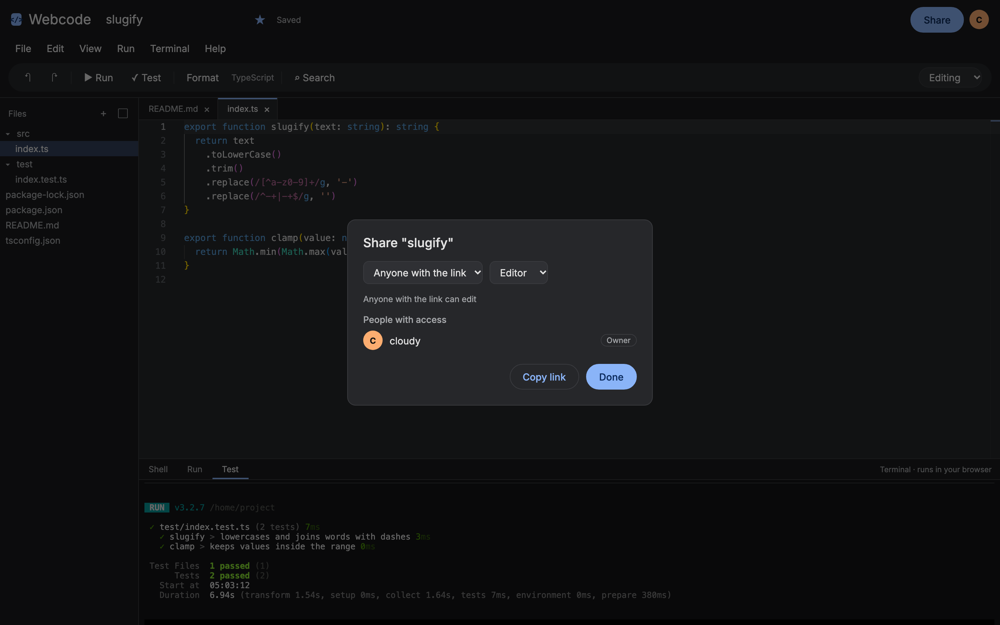

# Webcode

**Google Docs for coding.** Open a real JavaScript/TypeScript project in your browser, share a link, edit the same files together in real time, and install, run, and test it — with nothing to install.

## Demo

[](docs/demo.mp4)

▶️ **[Watch the 13-second demo](docs/demo.mp4)**: landing page, home, opening a project, and running its tests right in the browser.



## Highlights

- **Real-time collaboration** — shared editing with live cursors, name tags, and presence, powered by Yjs CRDTs.
- **Runs entirely in the browser** — `npm install`, dev servers, and test runners execute inside StackBlitz WebContainers, so the server never runs untrusted code.
- **Docs-style sharing** — restricted, view-only, or edit links; guests join with just a name.
- **Full workspace** — file explorer, Monaco editor tabs, terminals, Run/Test, and a live app preview.
- **Instant demo** — every visitor gets a private, self-cleaning demo copy.
- **Templates and GitHub import** — React, Node API, TypeScript library, or any public repo.

## Screenshots

| Landing | Home |
|---|---|
|  |  |

| Running tests in the browser | Live preview |
|---|---|
|  |  |

| Sharing |
|---|
|  |

## Architecture

```
Browser (React + Vite)                      Webcode server (single Node process)
 ├─ Monaco + y-monaco ─┐                     ├─ Hono HTTP API (auth, projects, sharing, import)
 ├─ Yjs doc + presence ┼── WebSocket ──────► ├─ Hocuspocus (Yjs sync, access control)
 ├─ WebContainer (Node)│                     ├─ serves the built SPA (same origin)
 └─ xterm.js terminals ┘                     └─ PostgreSQL (users, projects, Yjs state)
```

| Layer | Technology |
|---|---|
| Frontend | React 19, Vite, TypeScript, Monaco, xterm.js |
| Collaboration | Yjs, Hocuspocus |
| Code execution | WebContainers (in the visitor's browser) |
| Backend | Node 22, Hono, `postgres` |
| Database | PostgreSQL (Neon-ready: pooled app traffic, direct migrations) |
| Testing | Vitest (290+ unit/integration tests), Playwright end-to-end |

## Getting started

**Prerequisites:** Node 22, pnpm 10, PostgreSQL.

```bash
pnpm install
# create .env.local with the variables below
pnpm dev                     # server on :8080, web app on :5173
```

| Variable | Purpose |
|---|---|
| `DATABASE_URL` | PostgreSQL connection string (pooled) |
| `DATABASE_URL_UNPOOLED` | Optional direct connection used for migrations |
| `GITHUB_CLIENT_ID` / `GITHUB_CLIENT_SECRET` | GitHub OAuth app for sign-in |
| `SESSION_SECRET` | Long random string for signing cookies |
| `PUBLIC_URL` | Public origin, e.g. `http://localhost:5173` |

Migrations run automatically on server start.

## Testing

```bash
pnpm test          # unit + integration (set DATABASE_URL_TEST)
pnpm typecheck
pnpm e2e           # Playwright: collaboration, access, running code, demo
```

## Deployment

The repository includes a production `Dockerfile` and `fly.toml`. Webcode keeps live documents in memory, so run it as a **single instance** (`fly deploy --ha=false`).

```bash
docker build -t webcode .
```

## Limits

Projects up to 2,000 files and 10 MB; files up to 1 MB; 20 projects per user. Code execution supports JavaScript/TypeScript on Node (a WebContainers constraint). WebContainers are free for personal and open-source use; commercial use requires a StackBlitz license.

## Roadmap

- Collaborative coding agents
- Timed code battles between friends
